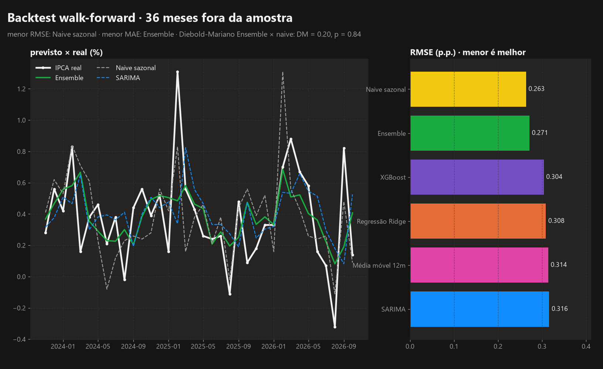
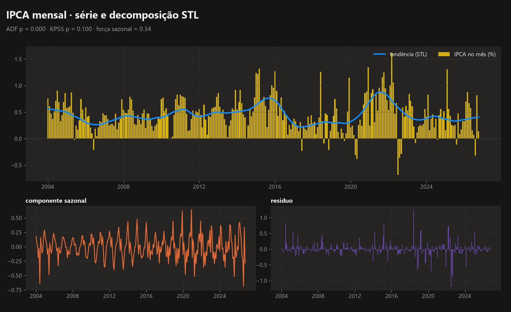
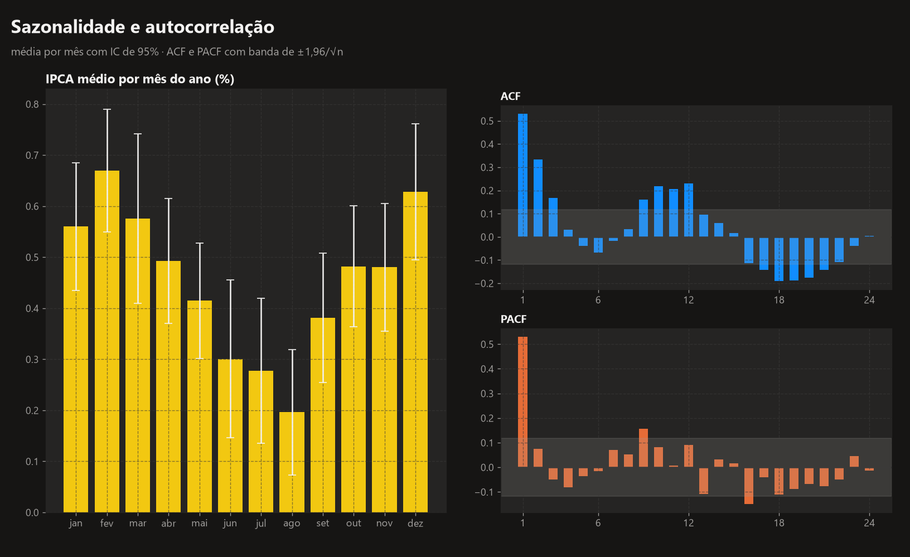
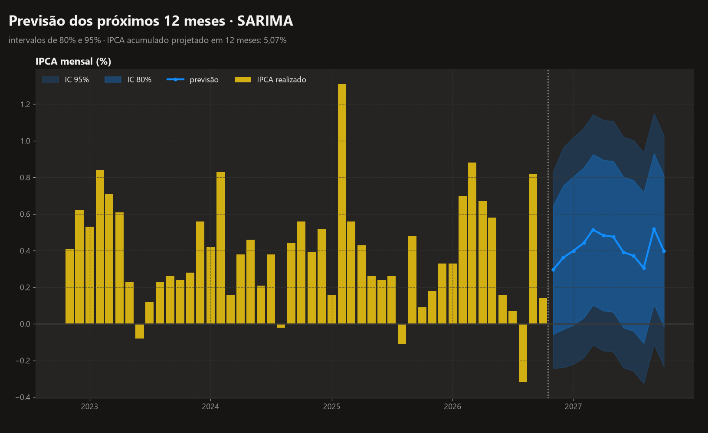

# 📈 Previsão de inflação (IPCA) · estatística + séries temporais + ML

Estudo de ciência de dados com dados oficiais do Banco Central: análise estatística da série do IPCA,
comparação honesta de **6 modelos de previsão** em backtest fora da amostra e projeção dos próximos 12 meses
com intervalos de confiança.

<p align="center">
  
</p>

## Perguntas que o projeto responde

1. **A série é estacionária?** ADF (H0: raiz unitária) e KPSS (H0: estacionária) concordam: o IPCA mensal é estacionário (ADF p < 0,001; KPSS p = 0,10).
2. **Quanto pesa a sazonalidade?** Decomposição **STL** robusta e força sazonal (Hyndman) de **0,34**; fevereiro e dezembro têm a maior inflação média, agosto a menor (médias com **IC de 95%**).
3. **Que estrutura de dependência existe?** ACF/PACF com banda de ±1,96/√n: forte dependência no lag 1 e componente sazonal no lag 12.
4. **Modelos sofisticados batem o básico?** Backtest **walk-forward** de 36 meses, um passo à frente, cada modelo vendo só o passado:

| Modelo | MAE | RMSE |
|---|---|---|
| Naive sazonal | 0,218 | **0,263** |
| Ensemble (média de 4 modelos) | **0,201** | 0,271 |
| XGBoost (lags + Selic + câmbio) | 0,237 | 0,304 |
| Regressão Ridge | 0,240 | 0,308 |
| Média móvel 12m | 0,240 | 0,314 |
| SARIMA(1,0,1)(1,0,1)₁₂ | 0,237 | 0,316 |

5. **A diferença é significativa?** Teste de **Diebold-Mariano** (com correção de Harvey) contra o naive sazonal: nenhum modelo é estatisticamente melhor (p > 0,28). Conclusão: a inflação mensal é dominada por sazonalidade e choques; a combinação de modelos reduz o erro absoluto, mas o naive sazonal continua sendo uma referência difícil de bater, e o projeto mostra isso em vez de esconder.
6. **E os próximos 12 meses?** SARIMA com intervalos de 80% e 95%; o acumulado projetado fica em `docs/resultados.json`.

<p align="center">
  
  
</p>
<p align="center">
  
</p>

## Como rodar

```bash
pip install -r requirements.txt
python run.py --atualizar   # baixa as séries e gera docs/ (gráficos, resultados.md e resultados.json)
pytest -q                   # inclui teste de que o walk-forward não vaza dados do futuro
```

## Estrutura

```text
previsao/dados.py         # coleta SGS/BCB (IPCA, Selic, dólar) e base mensal
previsao/estatistica.py   # ADF, KPSS, STL, força sazonal, IC por mês, ACF/PACF
previsao/modelos.py       # naive sazonal, média móvel, SARIMA, Ridge, XGBoost + features defasadas
previsao/backtest.py      # walk-forward, métricas, ensemble e Diebold-Mariano
previsao/graficos.py      # gráficos do relatório
```

## Stack

Python · pandas · NumPy · statsmodels · SciPy · scikit-learn · XGBoost · matplotlib · pytest · GitHub Actions
